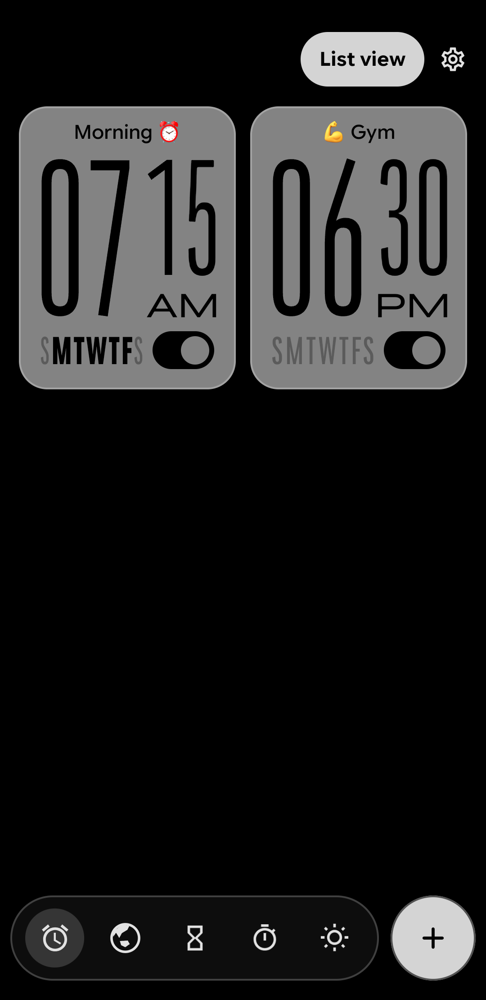
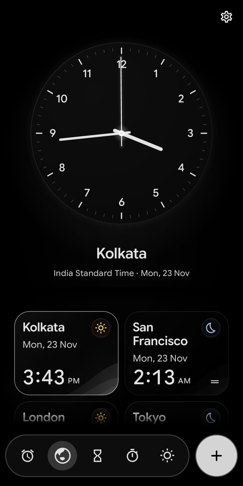
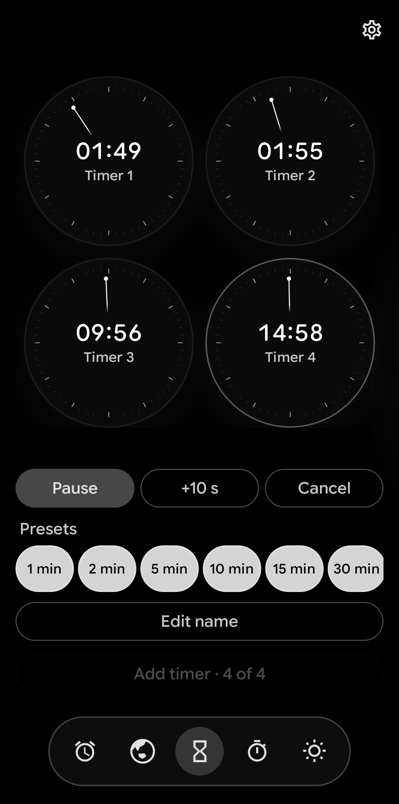
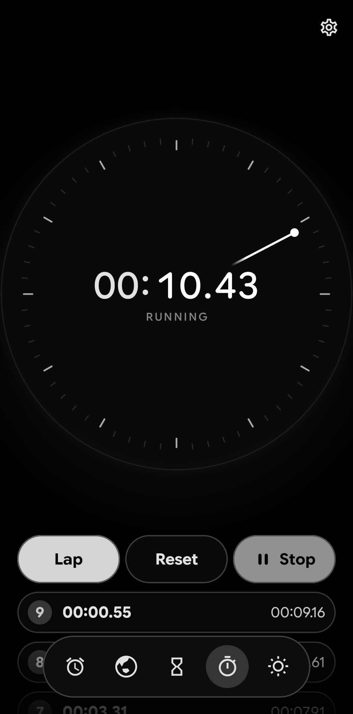
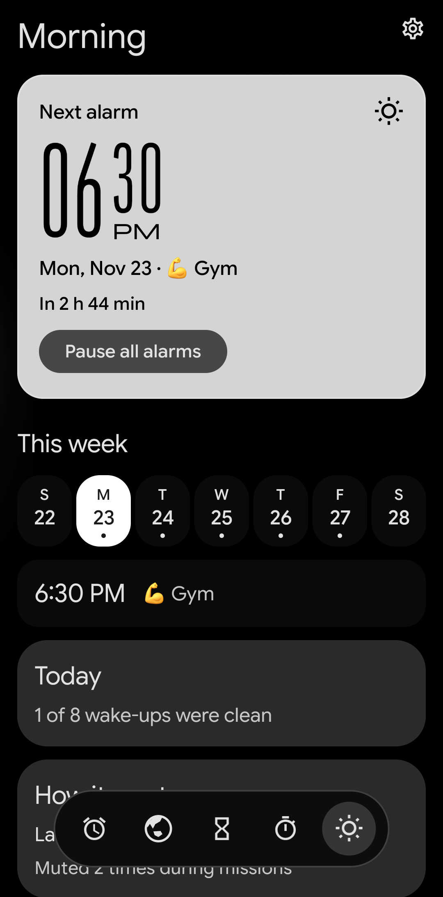
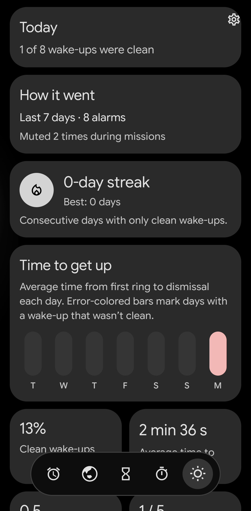
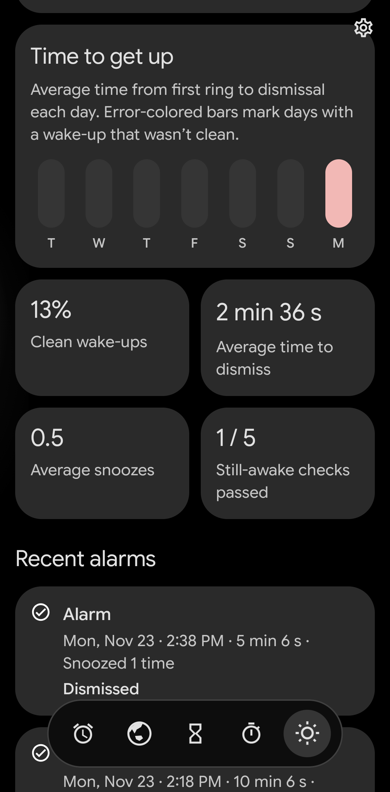
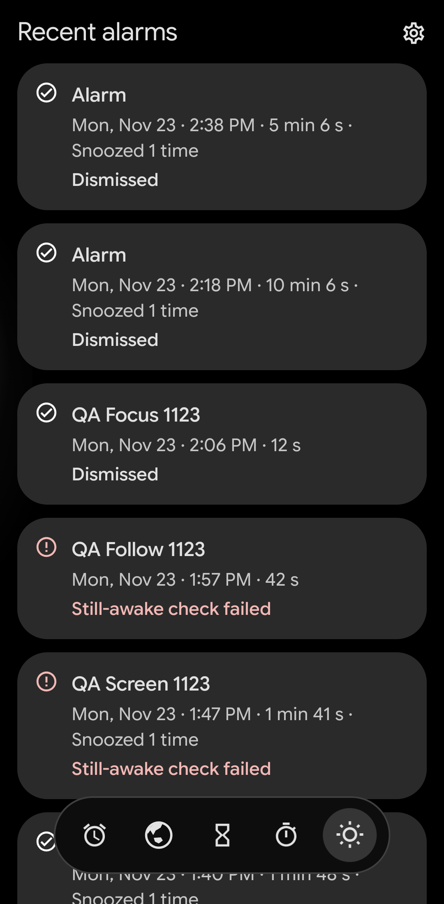

  

<h1 align="center">Wakr</h1>

<strong>Wake up on your terms.</strong>

Free and open source · Offline · ~5 MB download

Wakr is an offline alarm and clock app for Android with a modern Material 3 Expressive interface. Plan your mornings, make waking up interactive, and keep world time, timers, and a stopwatch close at hand.

## Screenshots

| Alarms | World Clock | Timers | Stopwatch |
| :---: | :---: | :---: | :---: |
|  |  |  |  |

| Morning | Wake-up Summary | Wake-up Stats | Recent Alarms |
| :---: | :---: | :---: | :---: |
|  |  |  |  |

## ✨ Features

- 🎨 **Modern design** — Material 3 Expressive, smooth transitions, and light, dark, and pure-black themes.
- 📅 **Flexible alarms** — Ring once, repeat on weekdays, pick specific dates, or schedule in another time zone.
- ⚡ **Quick alarms** — Set an alarm for a few minutes from now or have a one-time alarm delete itself after dismissal.
- 🔔 **Alarm heads-up** — New alarms default to a 30-minute reminder with a quick Skip action when available.
- 🧠 **Wake-up missions** — Try, customize, and reorder Focus Tap, Memory, Math, Typing, and Puzzle challenges.
- 🔒 **Pre-ring lock** — Require a mission to change or skip an alarm close to ring time.
- 👀 **Still awake?** — Confirm you’re awake after dismissal with an optional Medium Focus Tap check.
- 📳 **Shake to snooze** — When snooze is enabled, five distinct shakes snooze the alarm, and you can try it in Preview.
- 🔊 **Sound and vibration** — Choose your sounds, rotation, fade-in, vibration pattern, and mute limits.
- 🌅 **Morning dashboard** — See your next alarm, check this week’s schedule, and track your wake history.
- 🌍 **Offline world clock** — Search for cities, reorder your favorites, and watch the hands glide to the selected time zone.
- ⏳ **Four simultaneous timers** — Name each countdown and see how long it’s been overdue.
- 🏁 **Stopwatch laps** — Record split times with the fastest and slowest laps highlighted.
- 🕰️ **Clock widgets** — Add a translucent analog clock widget with a sweeping seconds hand, or choose a customizable digital clock widget.
- 💾 **Backup and restore** — Export your Wakr data to a local file and preview it before restoring.

## 📲 Download

Download **Wakr-1.0.0.apk** (about 5 MB) from the **Assets** section of the [Wakr 1.0.0 release](https://github.com/Masteratwork2049/Wakr/releases/tag/v1.0.0). Requires Android 8.0 or later.

Upgrading from a test-key preview? Export a backup first if the preview supports it. Android requires uninstalling that preview before installing the production-signed APK, and uninstalling clears its local data.

## 🔐 Privacy

Wakr works offline and requires no account. Android may ask for notification or alarm permissions so alerts work as expected.

## Building from source

Wakr is built with Kotlin and Jetpack Compose. Its Android package is `com.wakr.app`. Android installs it separately from the earlier Expressive Wake and Wake Form previews. Any alarms stay with the app that created them.

1. Clone this repository.
2. Open the project in Android Studio.
3. Allow Gradle to sync and download the required dependencies.
4. Build and run the app on a compatible Android device or emulator.

You can also use the included Gradle wrapper to build the project from the command line.

## 🙌 Acknowledgements

Wakr builds on Sam Beckman’s [Expressive Clock](https://github.com/samuelbeckman/expressive-clock), which builds on Rayane Bouafia’s [Material Clock](https://github.com/rbouaf/material-clock).

[Clock by BlackyHawky](https://github.com/BlackyHawky/Clock) and [WakeNudge by riyadmondol2006](https://github.com/riyadmondol2006/WakeNudge) inspired some features. Wakr adds its own features, designs, and refinements.

## Licence

The project's original source code is licensed under the MIT Licence. See [LICENSE](LICENSE) for the full licence text.

Bundled font files are licensed separately under the SIL Open Font License 1.1. See [THIRD-PARTY-NOTICES.md](THIRD-PARTY-NOTICES.md) and the files in the `licenses/` directory for details.

Google, Google Sans, Material, Android and Pixel are trademarks of Google LLC. Wakr is an independent project and is not affiliated with, sponsored by or endorsed by Google.
